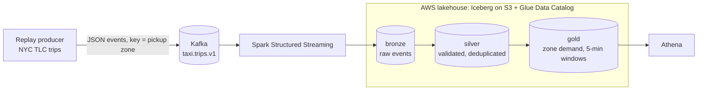

# streaming-lakehouse

A real-time pipeline for NYC taxi trips. A replay producer turns TLC trip records into a live event stream on Kafka. Spark Structured Streaming will process that stream with event-time semantics and write Iceberg tables into the AWS lakehouse from [lakehouse-aws](https://github.com/harshu-29-hr/lakehouse-aws), where they sit next to the batch tables and can be queried in Athena.

**Status:** milestone 1 of 6 done (Kafka + replay producer). See the [roadmap](#roadmap).

## Architecture (target)



## Quickstart

Needs Docker Desktop, Python 3.11 and make.

```bash
make up                           # Kafka (KRaft), the topic, and the Kafbat UI at http://localhost:8090
make produce ARGS="--limit 5000"  # sets up .venv, downloads January 2025, replays 5,000 trips at 60x
make produce-chaos                # the full month at 60x (about 12 hours), 5% late, 2% duplicates
make peek                         # print 5 events with their key and partition
make reset                        # wipe Kafka and start again with an empty topic
```

Run `make` to list every command. `SPEED=600` replays faster, `SPEED=0` replays as fast as possible, and `MONTH=2024-06` picks another month.

| Service | Address |
| --- | --- |
| Kafka, from your machine | `localhost:9092` |
| Kafka, from other containers | `kafka:19092` |
| Kafbat UI | http://localhost:8090 |

## The data

January 2025 yellow taxi trips, profiled with `make profile` before designing the producer:

| Finding | Value | What it decided |
| --- | --- | --- |
| Trips in the file | 3,475,226 | |
| Trips dated outside January | 1,811 (0.05%), as early as Dec 18 | Replay only the file's own month |
| Rows missing 5 fields at once | 540,149 (15.5%) | Events allow nulls; the producer never guesses |
| Negative fares / zero-distance trips | 4.15% / 2.62% | Passed through untouched; validation belongs in silver |
| Trips per hour | 155 quietest, 4,669 average, 13,598 busiest | Default speed 60x, about 3 to 227 events per second |
| Busiest pickup zone | 161 (Midtown Center), 4.89% of trips | No single zone dominates, so pickup zone works as the key |

## Events

One JSON event per completed trip on `taxi.trips.v1` (3 partitions), shown here spread over lines:

```json
{
  "event_id": "5b0f6c2e-9f3a-5d41-8e7b-2c6a1f0d9e44",
  "event_type": "trip_completed",
  "schema_version": 1,
  "vendor_id": 2,
  "pickup_time": "2025-01-01T00:03:12",
  "event_time": "2025-01-01T00:17:45",
  "passenger_count": 1,
  "trip_distance": 2.41,
  "pu_location_id": 161,
  "do_location_id": 237,
  "payment_type": 1,
  "fare_amount": 14.9,
  "tip_amount": 3.9,
  "total_amount": 23.8,
  "produced_at": "2026-09-28T18:04:31.207+00:00"
}
```

## Design notes

- **Event time is the dropoff time,** as TLC records it (NYC local time, no offset). `produced_at` is the wall-clock UTC send time, for measuring end-to-end latency.
- **The key is the pickup zone,** so each zone's events land on one partition, in order. The producer uses the `murmur2_random` partitioner so Python and Kafka's Java tools send the same key to the same partition.
- **Known skew:** five of the ten busiest zones hash to partition 2, so it carries more traffic than the others. That's acceptable at this volume; the fixes would be more partitions or a different key.
- **`event_id` is deterministic** (UUIDv5 of the fields that identify a trip), so a redelivered trip keeps its ID and can be deduplicated downstream.
- **Two kinds of duplicates:** the idempotent producer stops broker-level duplicates from network retries. Business-level duplicates (`--dup-rate`) are separate sends on purpose, and handling them is the pipeline's job.
- **Late events are held back in event time** (`--late-rate`, up to `--late-max-minutes`), so lateness behaves the same at any replay speed. A fixed `--seed` makes every chaos run repeatable.
- **Record timestamps stay at send time.** Stamping Kafka records with January dates would make the 7-day retention delete them.
- **The producer cleans nothing.** Bronze should be a faithful copy of the source, so it can always be audited or reprocessed.

## Project layout

| Path | What it is |
| --- | --- |
| `docker-compose.yml` | Kafka (KRaft), the topic setup job, and the Kafbat UI |
| `producer/replay_producer.py` | The replay producer |
| `scripts/explore_trips.py` | Data profiling for one month of trips |
| `Makefile` | Shortcuts for everything above |
| `requirements.txt` | Pinned Python dependencies |

## Roadmap

- [x] 1. Kafka (KRaft) + replay producer with late and duplicate injection
- [ ] 2. Bronze: Spark Structured Streaming from Kafka into Iceberg on S3 (Glue catalog), exactly-once through checkpoints; Terraform for the new AWS pieces
- [ ] 3. Silver: parsing, validation, dedup on `event_id` with watermarks, bad records routed aside
- [ ] 4. Gold: 5-minute zone demand and revenue windows, queried in Athena
- [ ] 5. Ops: Iceberg compaction and snapshot expiry in Airflow; lag and throughput metrics
- [ ] 6. Tests, CI with Kafka in GitHub Actions, design write-up and cost notes